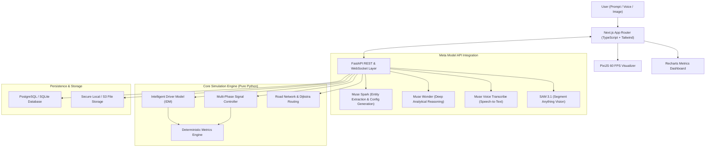

# Dream2Sim System Architecture

Dream2Sim is an AI-powered idea-to-simulation platform that converts natural language scenario descriptions into deterministic, interactive, data-driven simulations.

## High-Level System Architecture

## Architectural Layers

1. **Presentation Layer (Frontend)**:
   - Next.js 16 with App Router and React 19.
   - PixiJS WebGL canvas decoupled from discrete physics clock for smooth 60 FPS rendering.
   - Recharts dynamic time-series charts.
   - Tailwind CSS dark-first design system.

2. **Application & API Layer (Backend)**:
   - FastAPI asynchronous web framework with Pydantic v2 validation.
   - Clean architecture separating API endpoints, domain models, services, and simulation engine.
   - Asynchronous SQLAlchemy 2.0 with Alembic migrations.

3. **Simulation Physics Engine**:
   - Discrete-time deterministic simulation architecture ($dt = 0.2\text{s}$).
   - Microscopic car-following dynamics via the Intelligent Driver Model (IDM).
   - Multi-phase signal controllers with yellow transition intervals.
   - Road closures, incident routing, and queue heatmaps.

4. **Meta Model API Integration Layer**:
   - Official base URL: `https://api.meta.ai/v1`.
   - Tool calling and Structured Outputs.
   - Muse Spark for parsing and configuration.
   - Muse Wonder for post-run analytical reasoning.
